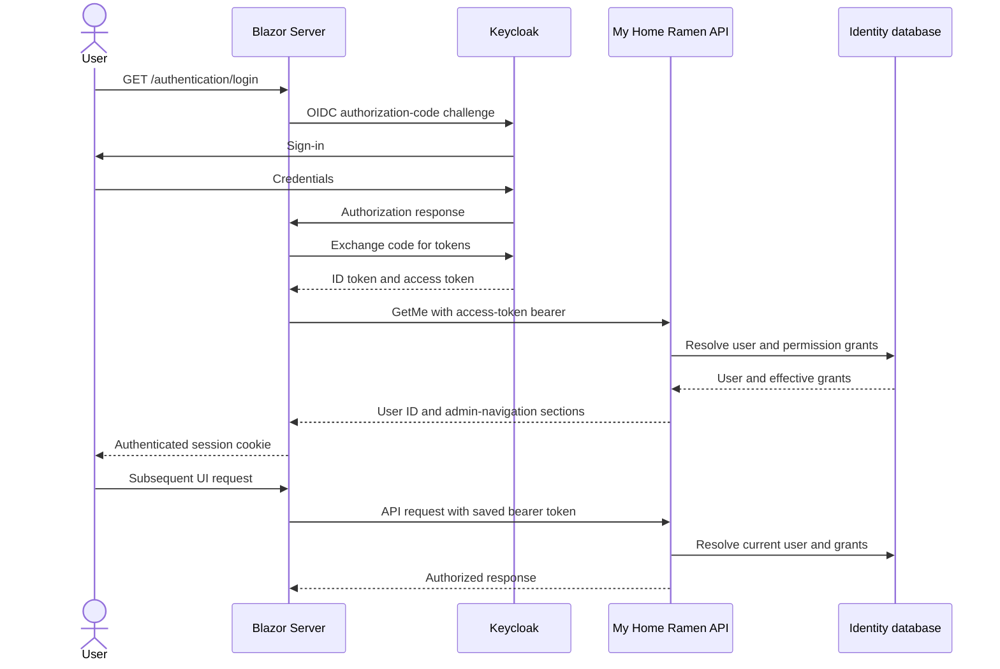
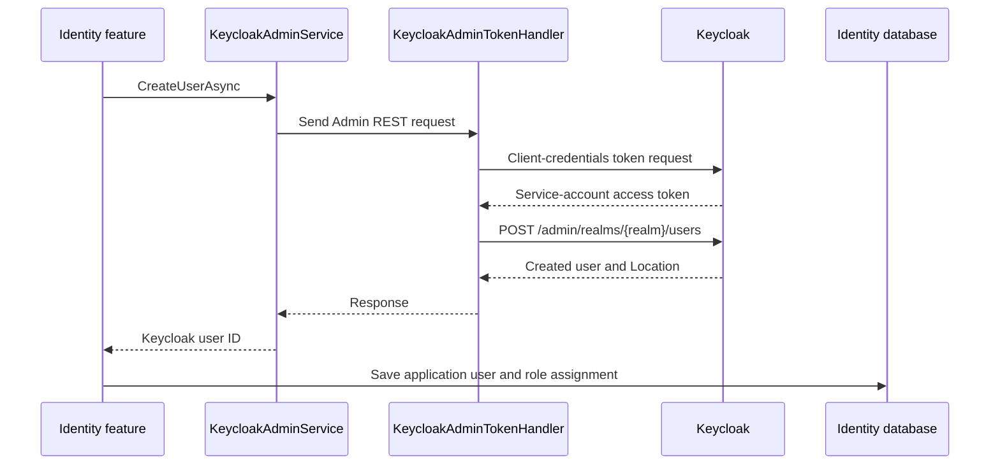

# Authentication and Keycloak flows

Keycloak authenticates users and issues OpenID Connect tokens. The API
validates access tokens; application users and their permissions are resolved
from the Identity database.

## Blazor sign-in and API requests

The Blazor Server app uses OIDC authorization-code flow and cookie sign-in.
Tokens are saved in the authentication ticket. API clients forward the saved
access token as a bearer token. During OIDC token validation, Blazor calls the
Identity API `GetMe` endpoint and adds application user and admin-navigation
claims to the signed-in principal.

The API, not the Blazor UI, remains the security boundary. Hiding a page or
navigation item is not sufficient authorization.

### Current components

- `MyHomeRamen.Blazor\MyHomeRamen.Blazor\Infrastructure\Authentication\AuthenticationDependencyInjection.cs`
  configures Keycloak OIDC, code flow, token saving, and claims enrichment.
- `AuthHeaderHandler` forwards the saved access token. `AdminAuthHeaderHandler`
  also adds `x-scheme: RestaurantManager`.
- API endpoint authentication uses JWT bearer validation configured in
  `MyHomeRamen.Api\Authorization\AuthorizationDependencyInjection.cs`.
- `KeycloakClaimsTransformation` maps Keycloak's subject claim to the
  application `domain_id` claim when a matching user exists.
- `UserLoginMiddleware` and `AuthorizationService` resolve the current
  application user and load effective permission grants for the request.

Blazor requests `openid`, `profile`, `my-home-ramen-scope`, and `menu` scopes.
Those OIDC scopes are not substitutes for database permission checks.

## Backend-to-Keycloak administration

User registration also calls Keycloak's Admin REST API. This is a separate
service-to-service flow: the backend obtains a client-credentials token using
the configured Keycloak admin client, then creates the Keycloak user. The
returned Keycloak user ID is stored on the application `User` record.

The admin access token is cached for a configured lifetime. The token handler
clears the cached token and retries once if Keycloak responds with 401.
Keycloak user creation and database persistence are separate operations, not a
single transaction; registration failure handling should account for possible
partial completion.

Company-owner onboarding uses this same backend provisioning flow. The
application user receives the `Customer` and `CompanyOwner` roles. A separate
company-setup workflow then creates the initial Company and Restaurant in the
Restaurants module; that setup does not create a Keycloak role or replace
Identity authorization.

## Logout

`POST /authentication/logout` signs out of both the application cookie and
OIDC schemes. The configured post-logout redirect is `/`.
