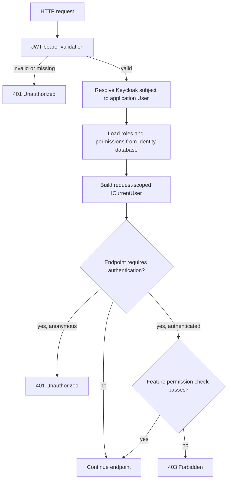

# Backend authorization

The API has two distinct checks:

1. **Authentication:** Is the request's bearer token valid and its principal
   authenticated?
2. **Authorization:** Does the resolved application user have permission for
   this operation and resource?

## Request identity and permission loading

The API validates access tokens using configured authority, audience, and
issuer. `UserLoginMiddleware` calls `AuthorizationService` for each request.
That service resolves a domain user by `domain_id`, Keycloak ID, or guest ID,
then loads the user's effective `PermissionGrant`s from assigned roles.

`PermissionQuery.ByUserId` joins user-role assignments, role-permission
assignments, roles, and permissions. The resulting grants carry optional
`RestaurantId`; permissions are therefore resolved from current database state,
not copied wholesale into Keycloak tokens.

Guests are represented by application users too. For unauthenticated requests,
Blazor may forward the `guest_id` cookie to the API; the API uses it to resolve
the guest user and assigned guest permissions.

## Enforcement points

- Endpoint `.RequireAuthorization(...)` metadata requires an authenticated
  principal. The configured `AuthenticatedUser` policy uses the API's JWT
  bearer scheme.
- Feature handlers can have a request-specific `IAuthorizationPolicy<TRequest>`.
  `AddHandlers` discovers these policies and wraps matching handlers in
  `AuthorizationHandler<TRequest,TResponse>`.
- Feature logic can use `ICurrentUser.HasPermission`,
  `HasAnyPermission`, and `RestaurantIdsFor` for permission and scope checks.
- Blazor derives admin-navigation claims from the API's `GetMe` response and
  uses UI authorization policies to show or hide sections. These checks improve
  UX; API authorization remains mandatory.

An unauthenticated request is normally rejected with 401. An authenticated
user who lacks the required permission should receive 403. Specific feature
endpoints may have additional behavior.

## Restaurant scope

An unscoped grant (`RestaurantId == null`) applies without a restaurant ID.
A restaurant-scoped grant applies to a specific restaurant when the permission
is marked resource-scoped and the requested restaurant ID matches. Use
`HasPermission(module, permission, restaurantId)` for a specific resource.

`HasAnyPermission` only answers whether any matching grant exists; it does not
prove access to a particular restaurant. Use `RestaurantIdsFor` to get the
restaurant IDs attached to scoped grants.

## Refactor boundary

The accepted [ADR-0004](../Users%20ADR/0004-company-restaurant-roles-and-authorization.md)
defines company and restaurant memberships, active membership checks,
restaurant context validation, and cache invalidation. Those rules must not be
assumed implemented until corresponding code exists. Current implementation
uses `User`, `Role`, user-role assignments, and optional `Role.RestaurantId`.

