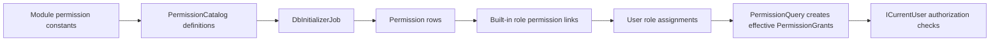

# Permission catalog synchronization

`PermissionCatalog` is the source of truth for application permission
definitions. `PermissionCatalogSynchronizer` brings the Identity database and
built-in role permission sets in line with that catalog.

## Trigger

The database initializer runs migrations and then invokes
`IPermissionCatalogSynchronizer.Synchronize`. Synchronization impersonates the
system account before changing Identity data.

## Synchronization behavior

For definitions in the code catalog, the synchronizer:

- Adds missing permission rows.
- Updates changed descriptions and `IsResourceScoped` values.
- Removes database permissions no longer present in catalog for modules still
  represented in the catalog.
- Rebuilds permission links for `RestaurantAdmin`, `Guest`, `Customer`, and
  `CompanyOwner`, creating a built-in role if it does not exist.

The admin role receives all catalog permissions. Other built-in role
permission sets come from catalog subsets and customer-specific profile rules.
Role synchronization updates those built-in assignments; it is not a Keycloak
role update.

## Operational notes

- This is database synchronization, not runtime discovery from Keycloak.
- Removing a permission from a catalog module can remove its database row and
  affect persisted role links. Review permission and role consequences before
  deleting identifiers.
- Modules absent from the catalog are not included in the set of modules used
  for stale-permission cleanup.
- Role and permission changes become effective after the synchronizer and
  database saves complete.
- This implementation does not document or implement the refactor ADR's
  membership events or authorization-cache invalidation.

When changing synchronization behavior, update its tests and this page.

