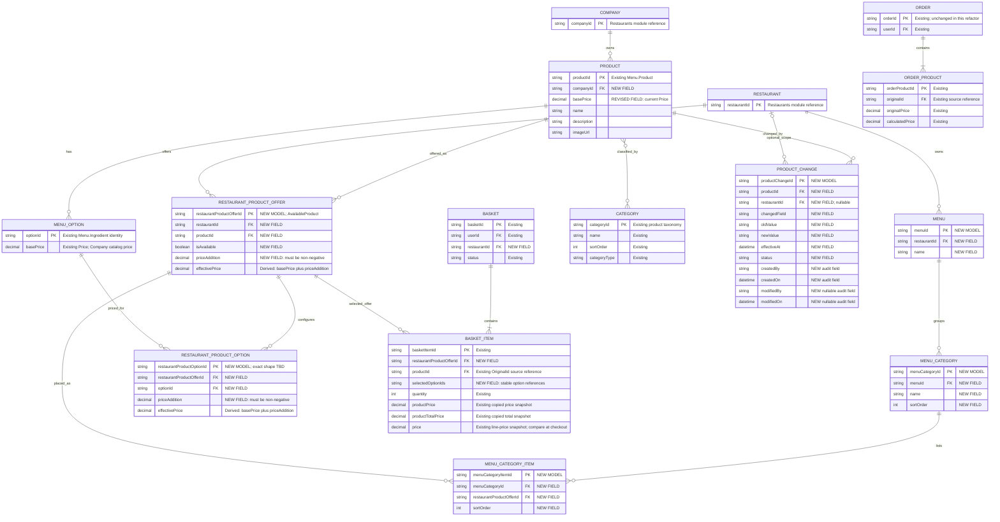

# Domain Model Analysis: Catalog, Restaurant Offers, Baskets, and Orders

## Purpose

This is a discussion draft, not an approved domain-model change. It explains the current model, a proposed direction, and decisions needed before implementation.

## The short version

Keep Menu as the source of product identity, but separate a Company product from each restaurant's offer and customer-facing menu cards. A Restaurant may have multiple Menu cards (for example, lunch and dinner); each Menu has its own menu sections and listed offers. Here, "global product" means shared across restaurants in one Company, not shared across every Company on the platform. The Company product owns the base price; a restaurant offer may add a non-negative fixed amount. Effective price is `BasePrice + PriceAddition`, so Company base-price changes flow through to every restaurant offer without changing its addition.

Keep basket data temporary, but retain a price snapshot so the customer can be notified when the current restaurant price changes. Re-check the offer at checkout, show changed-price information, and apply the current effective price. Order-model changes are outside this refactor.

Example: the same ramen exists once in a Company's catalog and can be offered by Restaurant A and Restaurant B. Each restaurant can list that offer on one or more of its Menu cards and may set a fixed non-negative addition to the Company base price. A basket points to one restaurant's offer and saves its displayed price for change detection. If that price changes, the menu and basket surface a warning, and checkout shows the change before applying the current price.

## What exists today

| Area | Current model and evidence | Gap this analysis identifies |
|---|---|---|
| Menu | `Menu.Product` owns name, description, price, image, ingredients, and categories (`MyHomeRamen.Domain/Menu/Products/Product.cs`). | The product has no Company or Restaurant ID, and no restaurant offer entity or restaurant-specific price/availability is defined in the reviewed Menu ADR or product model. Company ownership and tenant filtering therefore need to be added, not merely assumed. |
| Public menu categories | `Category` has `Name`, `SortOrder`, and `CategoryType`, but no Menu or Restaurant association (`MyHomeRamen.Domain/Menu/Categories/Category.cs`). `GetMenuCategoriesQuery` filters only `CategoryType.Product` and returns a flat `Id`/`Name` list; it accepts no Menu or Restaurant ID and does not project `SortOrder` (`MyHomeRamen.Features/Menu/Features/Categories/GetMenuCategories/GetMenuCategoriesQuery.cs`, `.../GetMenuCategoriesEndpoint.cs`). | The current category query cannot return the ordered sections for a selected Menu card. Product taxonomy categories and customer-facing menu sections need distinct, explicit roles. |
| Basket | `ShoppingCart.Basket` has a user and copied product records, but no restaurant ID (`MyHomeRamen.Domain/ShoppingCart/Baskets/Basket.cs`). The copied product includes `OriginalId`, name, description, price, image, and ingredients (`MyHomeRamen.Domain/ShoppingCart/Products/Product.cs`). | The basket copy can become stale, and the model does not say which restaurant owns it or which price is authoritative. |
| Order | `Orders.Order` stores product records. Each copied product has an `OriginalId`, name, original/calculated prices, paid state, and ingredients (`MyHomeRamen.Domain/Orders/Orders/Order.cs`, `MyHomeRamen.Domain/Orders/Products/Product.cs`). | The order and product models do not show a restaurant ID, explicit line quantity, currency, or tax/discount/fee breakdown. Confirm required historical and accounting fields before changing them. |
| Module contracts | The ADRs expect modules to communicate through external services rather than depend on each other's domain models. | New Menu data must be exposed as contracts/DTOs; Shopping Cart and Orders should not reference Menu entities directly. |

These are observations about the reviewed files and ADRs, not proof that no restaurant context exists elsewhere in the application. Inventory API, persistence, and client flows before implementation.

## Proposed model and behavior

| Concept | Proposed responsibility | What changes |
|---|---|---|
| Company Catalog Product | Shared product identity, information, and base price across that Company's restaurants. | Add Company ownership and tenant filtering. Do not expose one Company's catalog to another. |
| Restaurant Product Offer (`AvailableProduct`, new) | Connect one product to one restaurant; own restaurant availability and a non-negative fixed `PriceAddition`. | Calculate `EffectivePrice = BasePrice + PriceAddition`; reject negative additions and resolve offers through restaurant context. A Company base-price change automatically changes every offer's effective price. |
| Menu card (new) | A customer-facing menu owned by one Restaurant; a Restaurant may own multiple cards. | Give each card an identity and name, and query it explicitly rather than treating all product categories as one menu. Other lifecycle/scheduling fields remain to be decided. |
| Menu section and listing (new) | Organize restaurant offers into customer-facing sections on a specific Menu card. | Introduce menu-specific sections and an association that lists an offer under a section. Keep existing `Category` for product taxonomy unless a later decision explicitly reuses it. |
| Basket | Temporary selection for exactly one restaurant; retain offer/product references, selected option references, quantities, and the displayed effective price snapshot for each item. | Add/require restaurant context. Include selected-option prices in the snapshot; use it only to detect and explain changes. Checkout uses current effective prices. |
| Order line | Existing purchase record; changes to its model are outside this refactor. | Preserve the current Orders model and keep module integration compatible. Historical snapshot completeness is a separate decision/work item. |

“Restaurant-exclusive product” does not need a separate product identity: it can be a Company catalog product offered by only one restaurant. Restaurant-specific name, image, availability, or other presentation belongs on the offer only if the business confirms those fields can vary by restaurant.

### Restaurant menu cards and menu sections

A Restaurant may own multiple Menu cards. Each card contains its own ordered menu sections; sections list Restaurant Product Offers. A Restaurant Product Offer remains restaurant-scoped, so its availability and fixed price addition are shared across that Restaurant's Menu cards unless the business chooses menu-specific behavior.

Keep the existing `Category`/`CategoryType.Product` model for catalog taxonomy, not as the implicit source of every public menu's sections. Add a menu-specific section/listing model, or explicitly decide to evolve `Category` with Menu ownership; do not keep the current unscoped flat query as the public contract.

`GetMenuCategoriesQuery` currently has no parameters and returns all product categories as `{ Id, Name }`. Refactor its read contract to require a selected Menu identity and return that Menu's ordered sections (with IDs/names and, if required, listing data). Validate that the selected Menu belongs to the requested Restaurant. Exact route, response shape, and whether a product may appear in multiple sections/cards remain open; no code changes are included in this analysis.

### Company-scoped product management

The accepted authorization design makes Company the tenant boundary and defines CompanyOwner as company-scoped (`Wiki/Users ADR/0004-company-restaurant-roles-and-authorization.md`). Shared catalog changes should therefore require a company-scoped permission, not a restaurant-scoped permission. Restaurant staff should not be able to change shared product data merely because they manage one restaurant.

The ADR's initial permission catalog does not list Menu product-management permissions. Add company-scoped catalog permissions (for example, view/create/update/retire products) and make them assignable to a Company role; do not grant them to every CompanyOwner implicitly unless separately approved. The current `Role` entity only has nullable `RestaurantId`; reconcile that implementation with the accepted explicit Company/Restaurant role-scope design before building authorization around it.

### Planned edits and retirement

Do not treat every edit as an immediate overwrite. Represent planned changes with a `ProductChange` model containing `ProductId`, optional `RestaurantId` (Company product change when absent; restaurant-specific change when present), changed field, old value, new value, effective date/time, lifecycle state, and audit fields. An authorized actor should be able to choose what changes, where it applies, and when it takes effect:

1. Change shared product facts or base price at Company scope, or change restaurant-specific offer fields and fixed price addition at Restaurant scope.
2. Preview the affected restaurants and current versus proposed effective prices.
3. Keep current values active until the scheduled effective date/time, then apply the scheduled values.
4. Surface relevant product/availability changes on the menu with a warning color and exclamation mark. If a basket's saved price differs from the current effective price, show a warning badge on that basket item and explain the price change during checkout before applying the current price.
5. Keep an audit trail of who scheduled, changed, canceled, or rescheduled a change.

Menu-card, section, and listing assignments are Restaurant-scoped. Whether those changes are scheduled/audited, and whether they need a separate change model, remains open; the proposed `ProductChange` fields identify a Product and optional Restaurant, not a Menu or section.

Treat delete as retirement, not physical deletion. Retire a product across the Company only when it should leave every restaurant; otherwise disable or end-date the individual restaurant offer. At checkout, validate against the offer effective at that time and handle newly unavailable products explicitly. Retirement semantics and the response to an unavailable item still need confirmation.

The exact representation and lifecycle of `ProductChange` (including cancellation, rescheduling, and concurrent changes to the same field) still needs design. The scheduled-change model and audit trail are required; these details must not be replaced with immediate overwrites.

### Basket lifecycle

1. When adding an item, resolve the restaurant's current offer through the Menu contract.
2. Store stable IDs, selected options, quantity, and the displayed effective price snapshot for the product and selected options. Keep any other preview data refreshable.
3. Before checkout, re-check that the offer and selected options are available and obtain current prices from Menu.
4. If price changed, identify the affected basket item, show the changed amount and apply the current effective price. If the item became unavailable, explain that and require the customer to remove or replace it.

The user-facing warning is required on the menu, basket item, and checkout. The selected behavior is to apply the current price after showing the checkout notice; no separate accept/decline step was specified.

### Existing order boundary (out of scope)

Order-model changes are outside this refactor. Do not expand or migrate the Orders model here; keep the existing checkout integration compatible. A future Orders analysis should decide what information is required to read and explain historical orders independently of the current catalog.

Do not rebuild old orders from current Menu data. Historical snapshot completeness, correction/refund workflows, and accounting/retention fields need separate analysis.

## Decisions to confirm before implementation

| Decision | Current resolution / open point | Why it matters |
|---|---|---|
| Does “global product” mean shared across all restaurants in one Company? | Confirmed: shared within Company; never across Company tenants. | Defines catalog ownership and prevents cross-tenant exposure. |
| How is product price determined? | Confirmed: Company product owns base price; restaurant offer stores a non-negative fixed addition. Effective price is base plus addition, so base-price changes flow through automatically. Restaurant controls offer availability; menu-section listings decide which cards display it. | Determines price ownership, offer validation, and menu visibility. |
| Can each Restaurant have multiple Menu cards? | Confirmed: yes. Model each card under one Restaurant, with menu-specific sections and listings. | Enables distinct customer-facing menus without duplicating Company products or restaurant price offers. |
| How are menu sections/categories represented? | Proposed: add Menu-specific sections and offer listings; retain `Category` for product taxonomy. Reuse/evolution of `Category` remains an alternative to decide. | Separates product classification from the structure of each public menu. |
| Can a product/offer appear on multiple cards or sections, and can availability/price addition differ per card? | Proposed: the Restaurant Product Offer and its price addition are shared across that Restaurant's cards; section listings control where it appears. Confirm whether card-specific pricing or availability is required. | Determines whether offers remain restaurant-scoped or become menu-scoped. |
| What does the public menu-category query require? | Proposed: selected `MenuId` (and validated Restaurant context); return that Menu's ordered sections instead of every `CategoryType.Product` category. Route and DTO shape remain open. | Prevents unrelated categories and menus from leaking into the selected menu response. |
| Are Menu card, section, and listing changes scheduled/audited? | Open: decide whether these changes are immediate or scheduled and whether they use a separate change model from `ProductChange`. | `ProductChange` currently identifies Product and optional Restaurant, not Menu or section. |
| Who can create, edit, schedule, or retire shared products? | Confirmed: use assignable company-scoped catalog permissions. Exact permission names and which Company roles receive them remain to be designed. | Prevents restaurant-scoped users from changing shared catalog data and requires permissions not listed in the current initial catalog. |
| Which changes can be scheduled, and who sees the warning? | Confirmed: schedule product/offer changes with `ProductChange` and audit fields. Show relevant change/availability warnings on the menu; show a badge for affected basket items and explain price changes at checkout. Approval requirements and any additional audiences remain open. | Changes impact different audiences; visibility and timing determine UI and notification behavior. |
| What does “delete” mean, and at what scope? | Recommended, not yet confirmed: retire the Company product only when it should disappear everywhere; otherwise end the restaurant offer. Never hard-delete data needed by history. | Prevents one restaurant's choice from unexpectedly removing a product for all others. |
| Can a scheduled change be canceled or rescheduled, and is approval required? | Audit every change. Cancellation, rescheduling, approval, and same-field concurrency rules remain open. | Determines lifecycle, authorization, concurrency, and operational notifications. |
| What happens to a basket price after a scheduled price change? | Confirmed: keep a price snapshot for change detection; show a warning and apply the current effective price at checkout. No separate accept/decline step was specified. | Ensures customers see repricing and stale basket amounts are not charged. |
| Can one basket contain products from multiple restaurants? | Confirmed: exactly one restaurant per basket. | Otherwise fulfillment, pricing, and order ownership need explicit multi-restaurant rules. |
| Which product fields may vary by restaurant? | Confirmed: restaurant controls offer availability and may set a non-negative fixed price addition; Menu section listings control menu inclusion. Other presentation/content overrides remain to be decided. | Determines entity shape and prevents one restaurant's edits affecting another. |
| Who owns modifiers/ingredients, and can their price or availability vary by restaurant? | Confirmed: use the same Company base + non-negative fixed addition rule as products. Restaurant-specific modifier availability/inclusion remains open. | Affects Menu contracts and basket validation. |
| What must an order preserve? | Out of scope for this refactor. Do not change the Order model; analyze snapshot and accounting requirements separately. | Prevents order-model expansion from delaying the catalog and basket refactor. |
| How are existing baskets associated with a restaurant and new offer IDs? | Inventory persisted records first; define deterministic backfill and an operator-repair path for ambiguous rows. | Do not infer or discard basket data when the old model has no restaurant association. |
| What is the intended identity/lifecycle of `OriginalId` in copied products? | Confirm against API contracts, persistence, and usages before replacing it. | It may be the only link from a copied row to its Menu source. |
| What status should the Shopping Cart ADR have? | Keep `Proposed` until decisions are approved; reconcile its conflicting `Accepted` body text before changing status. | The current file says `Proposed` in metadata and `Accepted` in the body. |

Confirmed rows record decisions provided for this analysis. Open items remain unresolved; implementation must not silently turn their recommendations into approved policy.

## ADR evidence and unresolved contract

- Menu ADR (`Wiki/Menu ADR/0001-menu-domain.md`) makes Menu the product source of truth and expects Shopping Cart and Orders to keep copies. It says product changes during working hours are not expected and no synchronization mechanism is required.
- Shopping Cart ADR (`Wiki/Shopping Cart ADR/0001-shopping-cart-domain.md`) has `Proposed` metadata and conflicting `Accepted` body text. Keep it Proposed pending decision approval. It says copied data must be consistent with Menu when adding items and before checkout, while also saying no synchronization mechanism is required. Specify those validation points and their failure/price-change responses in the contract.
- Orders ADR (`Wiki/Orders ADR/0001-orders-domain.md`) describes order creation from Shopping Cart and consistency with Menu, but does not define the complete immutable snapshot contract.
- The reviewed ADRs do not define restaurant ownership, restaurant-specific offers, or restaurant-specific price/availability.
- Identity ADR (`Wiki/Users ADR/0004-company-restaurant-roles-and-authorization.md`) defines Company as the tenant boundary and CompanyOwner as company-scoped. It lists an initial permission catalog but no Menu product-management permissions.

## Scope of likely implementation work

Expected changes: Company-scoped catalog ownership and assignable permissions; Company base price plus restaurant-level fixed price additions; restaurant product offers; multiple Restaurant-owned Menu cards with menu sections and offer listings; a Menu-scoped public categories query; scheduled, audited `ProductChange` records; external Menu contracts; basket restaurant ownership and saved price snapshots; checkout revalidation and change warnings; persistence/migrations; API/client flows; authorization; and tests. Order-model changes and historical snapshot expansion are explicitly out of scope. Reconcile `Wiki/Domain Model Refactor Plan.md` with this boundary before implementation because its current phases include Order snapshot work.

Do not begin destructive basket-data cleanup or remove existing snapshot fields until data inventory, migration behavior, and consumers are verified.

## Domain diagram

`NEW MODEL` and `NEW FIELD` identify proposed additions. `REVISED FIELD` identifies a renamed or redefined current field. Company and Restaurant are owned by the Restaurants module; Menu stores their IDs, not references to their domain entities.

`MENU_CATEGORY` and `MENU_CATEGORY_ITEM` separate each Menu card's presentation sections/listings from existing product taxonomy categories. Restaurant offer pricing remains shared across cards unless menu-specific pricing is approved. `RESTAURANT_PRODUCT_OPTION` shows one possible link for restaurant-specific option price additions; the exact option availability/inclusion model remains open. Basket keeps current copied display data and its existing line-price snapshot for change detection, while adding restaurant/offer context. Checkout passes validated data to Orders through the module contract; diagram does not imply a direct Menu-to-Orders domain reference. Order model remains unchanged.

For further processing:

Verdict: The core design makes sense. Product → Restaurant Offer → Menu → Section → Listing is the standard pattern for multi-location catalogs. Keeping  Category  as taxonomy and adding menu-specific sections is correct. Fix the points below before implementation.

Risks, most serious first

1. Price rule  Base + non-negative addition  is too rigid.
• A restaurant can never be cheaper than the Company base price. That rules out promos, cheaper locations and discounts.
• Every base-price change silently raises all restaurant prices.
• Consider a nullable  PriceOverride , or allow a signed addition bounded by a floor. Otherwise confirm the business really never needs this.
2. Orders are out of scope, but baskets depend on them.
• An order with no restaurantId, quantity or currency cannot be attributed to a restaurant.
• I'd pull a minimal order change into scope:  RestaurantId , quantity, currency, and the final charged price per line.
• Without it, the new basket-to-restaurant ownership is lost at checkout.
3. Applying a higher price after only showing a notice is risky.
• It is a consumer-protection and UX problem. I'd require an explicit confirmation when the price goes up.
• A price decrease can be applied silently.
4.  ProductChange  with  changedField  /  oldValue  /  newValue  strings is fragile.
• There is no type safety, and  oldValue  goes stale if another change lands first.
• Prefer typed, effective-dated rows, for example  ProductPriceVersion(productId, price, validFrom)  and  OfferVersion . The current price is then a query by timestamp.
• A generic audit log can sit alongside those rows.
• If you keep scheduled changes, you need a Quartz worker to apply them, plus idempotency and a conflict rule for two changes to the same field.
5. Cross-module tenant invariant.
• An offer must satisfy  restaurant.CompanyId == product.CompanyId , but Restaurants and Menu are separate modules.
• Denormalize  CompanyId  on the offer and validate it through the Restaurants contract. Add a DB unique index on  (RestaurantId, ProductId) .
6. Naming and clarity.
• Use  MenuSection  instead of  MENU_CATEGORY , which is easy to confuse with  Category .
• The  MENU  entity inside the Menu module is ambiguous.  MenuCard  would be clearer.
•  MENU_OPTION  doesn't match the existing  Ingredient ; pick one name.
• Use the same name for  AvailableProduct  and  RestaurantProductOffer .
7. Smaller gaps
• Add scheduling to the menu (active window and days), since lunch/dinner is the stated use case.
• Give offers and products a status (Active, Retired) instead of an  isAvailable  boolean. Retiring a product should cascade to its offers.
•  BASKET_ITEM.productId  is redundant with the offer. Keep the offer ID and resolve the product from it.
• Currency and tax are missing everywhere.
• Add a unique constraint on  (MenuSectionId, OfferId) .
• Decide what happens to an offer that is listed but unavailable: hide it, or show it greyed out.
• The Menu ADR line "no synchronization required" now contradicts this design. Update the ADR.

I'd resolve points 1–3 first, since they change the core entities.