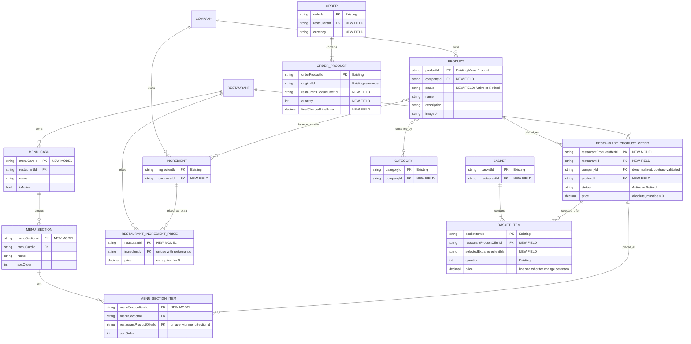

# Domain Model Analysis: Catalog, Restaurant Offers, Baskets, and Orders

## Purpose

Discussion draft, not an approved implementation contract. It records the current model, the agreed direction, and the decisions still open. Items marked **Open** must be decided by the developer before the work that depends on them starts.

## Scope

The project is a learning project (modular monolith, SignalR, SSE, background jobs) that may be commercialized later. Scope is deliberately limited:

- **Now:** backend prepared for Company and Restaurant ownership. UI behaves as one Company, many restaurants chosen by route (admin) or landing page (customer).
- **Parked:** Company selector, multi-Company admin UI, custom ramen builder, MenuCard scheduling, price versioning, Company-scoped roles (`Role` keeps nullable `RestaurantId`).

## The short version

- Company owns the **catalog**: `Product` and `Ingredient` (plus `Category`). The catalog holds no prices.
- **Prices exist only at restaurant level**, so each restaurant sets local prices:
  - `RestaurantProductOffer.Price` is the price of a product at a restaurant.
  - `RestaurantIngredientPrice.Price` is the price of an ingredient as an **extra** at a restaurant. No price record means the extra is not offered there.
- Base ingredients are included in the offer price. Only custom (extra) ingredients are priced.
- Line price = `OfferPrice + sum(restaurant prices of selected extras)`. Offer price must be `> 0`; extra price must be `>= 0`.
- Each Restaurant owns multiple `MenuCard`s with ordered `MenuSection`s listing offers.
- Customers pick a restaurant on a public landing page. The restaurant ID is stored on the Basket and sent with every basket, checkout, and order request. The server validates it.
- Menu and Shopping Cart reach Restaurants data through `IRestaurantService` (external contract, same pattern as `IPaymentService`).
- Basket keeps a price snapshot only to detect and explain changes. Checkout charges the current price after a notice.
- Order keeps restaurant, currency, quantity, and final charged line price.

## Simplicity decisions

| Dropped / deferred | Instead |
|---|---|
| Base price plus signed adjustment | Absolute restaurant price. No base-price flow-through. |
| Custom ramen builder (option groups, included picks) | Parked. Regular products with priced extras cover current needs. |
| `ProductPriceVersion` / scheduled price changes | Immediate overwrite. |
| Generic audit log | Standard created/updated actor/time fields. |
| MenuCard schedule | `Name` + `IsActive` only. |
| Cascade write on retirement | Offer hidden if offer or product is `Retired`; checked at read time. |
| Company selector, Company-scoped roles | Parked. `CompanyId` is a column only. |

## What exists today

| Area | Current model and evidence | Gap |
|---|---|---|
| Menu | `Menu.Product` owns name, description, `Price`, image, `BaseIngredients`, `CustomIngredients`, categories (`MyHomeRamen.Domain/Menu/Products/Product.cs`). | No Company or Restaurant ID, no offer, no restaurant pricing. `Price` must move to the offer. |
| Public menu categories | `GetMenuCategoriesQuery` returns a flat `Id`/`Name` list, no restaurant or card input. | Cannot return ordered sections of a selected card. |
| Available restaurants | `GetAvailableRestaurantsQuery` returns all restaurants for users who manage all, otherwise only `ManagedRestaurantIds()`. Policy requires `CanManageAnyRestaurant()`. | Staff-only. No public endpoint for customers. |
| Restaurant admin routes | `EditRestaurantPage` exists at `RestaurantRoutes.EditTemplate` and is an empty stub. | Restaurant-context menu editing is not built. |
| Cross-module service | `IPaymentService` (`Payments/ExternalApi`) implemented by `PaymentService` (`Payments/Services`), used by `UpdatePaymentDetailsCommand` in ShoppingCart. | Pattern to reuse for Restaurants. |
| Basket | `ShoppingCart.Basket` has a user and copied products, no restaurant ID. | Copy can go stale; no owning restaurant; no authoritative price. |
| Order | Product records with `OriginalId`, original/calculated prices, paid state, ingredients. | No restaurant ID, quantity, currency, or final line price. |

## Proposed model

| Concept | Responsibility | Rules |
|---|---|---|
| `Product` | Company catalog item: identity, info, base and custom ingredients, categories, `Active`/`Retired`. | Add `CompanyId`. Remove `Price`. Retire, never delete. |
| `Ingredient` | Company catalog ingredient. | Add `CompanyId`. No price. |
| `Category` | Product taxonomy. | Add `CompanyId`. Not the source of public menu sections. |
| `RestaurantProductOffer` (new) | One product offered by one restaurant at one price. `RestaurantId`, denormalized `CompanyId`, `ProductId`, `Price`, `Active`/`Retired`. | Unique `(RestaurantId, ProductId)`. `Price > 0`. Restaurant and Product must share a Company (checked via `IRestaurantService`). Hidden if offer or product is `Retired`. |
| `RestaurantIngredientPrice` (new) | Price of one ingredient as an extra at one restaurant. `RestaurantId`, `IngredientId`, `Price`. | Unique `(RestaurantId, IngredientId)`. `Price >= 0`. Missing record = extra not offered. |
| `MenuCard` (new) | Customer-facing menu owned by one Restaurant. `Name`, `IsActive`. | Multiple per restaurant. |
| `MenuSection` + `MenuSectionItem` (new) | Ordered sections; items place an offer in a section. | Unique `(MenuSectionId, RestaurantProductOfferId)`. |
| Basket | One restaurant. Items: offer ID, selected extra ingredient IDs, quantity, price snapshot. | Product resolved through the offer. |
| Order / line | `RestaurantId`, `Currency`; line `Quantity`, final price, offer reference. | Never rebuilt from current Menu data. |

An offer's status and price are shared by all of that Restaurant's cards; listings only control placement.

### Restaurant access for other modules

Add `IRestaurantService` in `Restaurants/ExternalApi` with an implementation in `Restaurants/Services`, registered like `IPaymentService`. Required capabilities (names are a proposal):

- Does the restaurant exist and is it active (for customer flows)?
- Which Company does the restaurant belong to (for `CompanyId` on write and the offer check)?

Menu and Shopping Cart depend only on this interface, never on Restaurants domain types.

### Restaurant selection

- **Staff:** `GetAvailableRestaurantsQuery` stays permission-filtered. Company owners see all; restaurant managers see their restaurants. A row opens the restaurant's edit/menu management route; the route ID is the context and the API re-validates it.
- **Customers:** new public (anonymous) endpoint lists active restaurants with a minimal DTO. The landing page makes the customer pick one. The ID is stored on the Basket and sent with requests; the server validates it. Never reuse the staff query for customers.

### Menu cards

Refactor `GetMenuCategoriesQuery` (`api/menu/categories/menu`, anonymous, flat `Id`/`Name`) into card-scoped endpoints.

Today the public page (`RestaurantMenuPage`) shows category chips from `GetMenuCategories`, then calls `GetProductsByCategory` for the selected category (`Id`, `Name`, `Description`, `Price`, `ImageUrl`, `Ingredients`). The new shape keeps the same UI idea (section chips, product cards) with sections replacing categories and offers replacing products.

#### Permissions

| Permission | Meaning |
|---|---|
| `MenuCard.View` | Read cards. Assigned to Guest and Customer roles. |
| `MenuCard.Add`, `MenuCard.Edit`, `MenuCard.Delete` | CRUD actions. |
| `MenuCard.Manage` | Admin gate. Admin actions require `Manage` plus one CRUD permission. |
| `Offer.View/Add/Edit/Delete/Manage` | Same convention for offers; `View` assigned to Guest and Customer. |
| `IngredientPrice.View/Add/Edit/Delete/Manage` | Same convention for per-restaurant extra-ingredient prices; `View` assigned to Guest and Customer. |

Naming uses `Add`, consistent with `Product.Add`. Grants carry an optional `RestaurantId`, so restaurant managers hold these per restaurant.

#### Public endpoints (require `MenuCard.View`)

`GET menu/cards/options` returns the cards a customer can choose from:

```csharp
public sealed record MenuCardOptionDto(Guid CompanyId, Guid RestaurantId, Guid MenuCardId, string Name);
```

Only active cards of active restaurants. Optional `restaurantId` filter is proposed.

`GET menu/cards/{id}` returns one card with ordered sections and offers (proposal modelled on the current menu page):

```csharp
public sealed record MenuCardResponse(Guid MenuCardId, Guid RestaurantId, string Name, IEnumerable<MenuSectionDto> Sections);
public sealed record MenuSectionDto(Guid Id, string Name, int SortOrder, IEnumerable<MenuOfferDto> Offers);
public sealed record MenuOfferDto(Guid OfferId, Guid ProductId, string Name, string Description, decimal Price, string ImageUrl, IEnumerable<ProductIngredientDto> Ingredients);
```

Offer `Price` is the restaurant price. Inactive or retired offers are omitted. Customization (extras with prices) loads through an offer-based replacement of `GetProductById`; its DTO is defined in Phase 3.

#### Public restaurants endpoint

`GET restaurants/options` (anonymous or `Restaurant.View`-style, active restaurants only):

```csharp
public sealed record RestaurantOptionDto(Guid Id, string Name, string Street, string City, string ZipCode, double Latitude, double Longitude);
```

`Address` has `Street`, `City`, `ZipCode`, and `Location`; it has no building field. Phone/email are not exposed publicly unless you decide otherwise.

### Edits and retirement

- Edits to price, offer, card, section, and listing take effect immediately.
- Delete means retirement. A restaurant may retire one offer without retiring the product.
- Public responses hide unavailable/retired offers.
- Checkout validates that offer and extras are still available.

### Basket lifecycle

1. On add, resolve the restaurant's current offer and extra prices through a Menu external contract (interface name and shape defined in Phase 1 inventory).
2. Store offer ID, extra ingredient IDs, quantity, and displayed line price snapshot.
3. Before checkout, re-check offer and extras are active and priced; fetch current prices.
4. Price changed: badge the item, notify on product card and at checkout, charge current price without confirmation. Unavailable: explain and require remove or replace.
5. Adding from a different restaurant asks the user to confirm replacing the basket. Declining keeps the current basket.

### Minimal order changes

`RestaurantId` and `Currency` on Order; `Quantity`, final charged price, and offer reference on each line. Tax, discount/fee breakdown, refunds are out of scope.

## Decisions

| Decision | Resolution |
|---|---|
| Catalog scope | Confirmed: Product, Ingredient, Category are Company-scoped; Company is the tenant boundary. |
| Prices | Confirmed: restaurant-level only (offer price and per-restaurant extra price). Catalog has no price. |
| Extras can be disabled per restaurant | Confirmed: no `RestaurantIngredientPrice` record means the extra is not offered. |
| Base ingredients | Confirmed: included in the offer price. |
| Custom ramen builder | Confirmed: parked. |
| Price change timing | Confirmed: immediate overwrite. |
| Auditing | Confirmed: standard created/updated fields. |
| Lifecycle states | Confirmed: `Active`/`Retired` on product and offer, hidden at read time. |
| Multiple cards per Restaurant | Confirmed. |
| Offer listed twice in one section | Confirmed: no. |
| Customer restaurant selection | Confirmed: landing page, restaurant ID attached to Basket and sent with requests. |
| Staff restaurant list | Confirmed: existing permission-filtered query. |
| Cross-module restaurant access | Confirmed: `IRestaurantService` in Restaurants `ExternalApi`. |
| Basket restaurants | Confirmed: one per basket; replace-basket confirmation. |
| Basket price change | Confirmed: snapshot for detection; notify; charge current price. |
| Unavailable offers | Confirmed: hidden. |
| Currency | Confirmed: one per Company; copied to each Order. |
| `Role` | Confirmed: keeps nullable `RestaurantId`; no explicit Company scope now. |
| Migrations | Confirmed: schema only, dev database recreated. |
| UI scope | Confirmed: UI keeps single-Company behavior; no Company selector. |
| `OriginalId` | Confirmed: keep as reference-only `ProductId`; `RestaurantProductOfferId` is the authoritative reference. |
| Shopping Cart ADR status | Keep `Proposed`; reconcile conflicting `Accepted` body first. |
| Taxes | Out of scope. |
| B-1 Permissions | Confirmed: `MenuCard.*`, `Offer.*`, `IngredientPrice.*` with `Add/Edit/Delete/View/Manage`. Admin action requires `.Manage` plus one CRUD permission. Guest and Customer roles get `.View`. |
| B-2 `CompanyId` source | Confirmed: `IRestaurantService`. |
| B-3 Public menu endpoints | Confirmed: `GET menu/cards/options` and `GET menu/cards/{id}`, both protected by `MenuCard.View` (see Public menu endpoints). Exact `{id}` response DTO is a proposal derived from the current menu page. |
| B-4 Offer shared across cards | Confirmed: yes, no card-specific pricing. |
| B-5 Sections replace categories | Confirmed: `GetMenuCategories` (`api/menu/categories/menu`) is replaced by card sections. `Category` stays product taxonomy. |
| B-6 Who sets prices | Confirmed: permission-based. `Offer.*` grants (restaurant-scoped via `PermissionGrant.RestaurantId`). Extra-ingredient prices use `IngredientPrice.*` grants. |
| B-7 Public restaurants endpoint | Confirmed: `GET restaurants/options`, DTO below. |
| B-8 Permission naming | Confirmed: `Add`, consistent with `Product.Add`. |
| B-9 Extra-ingredient price permissions | Confirmed: `IngredientPrice.*`. |

## ADR evidence

- Menu ADR: Menu is product source of truth; allows basket display snapshots; requires checkout revalidation and price-change disclosure.
- Shopping Cart ADR: `Proposed` metadata, `Accepted` body; says copied data must match Menu on add and before checkout yet requires no sync. Specify validation points in the contract.
- Orders ADR: order created from Shopping Cart; no complete snapshot contract.
- Identity ADR: Company is the tenant boundary; no Menu permissions listed.

## Implementation scope

1. `IRestaurantService` and the public restaurants endpoint.
2. `CompanyId` on Product, Ingredient, Category, Payments; remove `Product.Price`.
3. `RestaurantProductOffer` and `RestaurantIngredientPrice`.
4. `MenuCard`, `MenuSection`, `MenuSectionItem`, card-scoped query.
5. Basket restaurant/offer/extras/snapshot, checkout revalidation.
6. Minimal Order fields.
7. Customer landing page and minimal UI adaptation.

## Domain diagram


